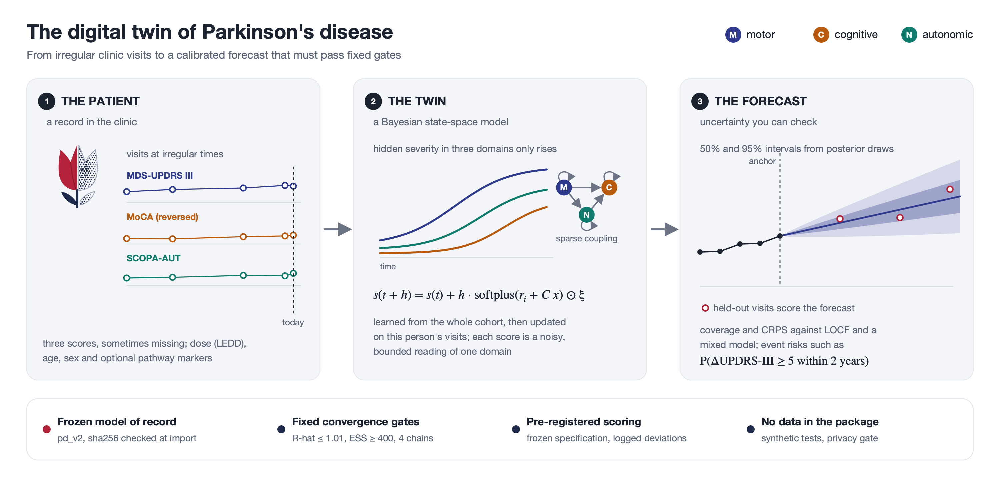
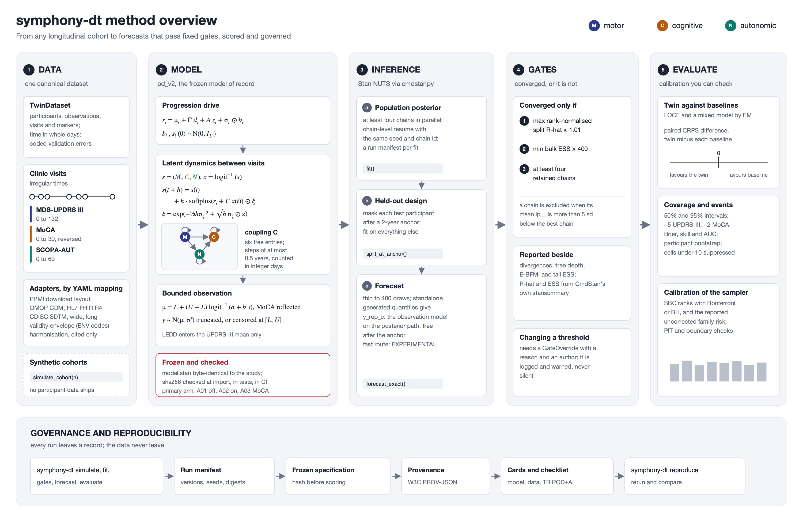

<p align="center">
  <picture>
    <source media="(prefers-color-scheme: dark)" srcset="https://raw.githubusercontent.com/a7med7emedan/symphony-dt/v2.0.1/docs/assets/brand/symphony-dt-wordmark-dark.png">
    
  </picture>
</p>

<p align="center">Bayesian hierarchical state-space digital twins for longitudinal clinical cohorts.</p>

<p align="center">
  <a href="https://pypi.org/project/symphony-dt/"></a>
  <a href="https://pypi.org/project/symphony-dt/"></a>
  <a href="https://github.com/a7med7emedan/symphony-dt/actions/workflows/ci.yml"></a>
  <a href="https://a7med7emedan.github.io/symphony-dt/"></a>
  <a href="https://a7med7emedan.github.io/symphony-dt/"></a>
  <a href="https://github.com/a7med7emedan/symphony-dt/blob/main/LICENSE"></a>
  <a href="https://doi.org/10.5281/zenodo.24029869"></a>
</p>

symphony-dt builds, checks, calibrates, forecasts with and audits Bayesian digital twins of longitudinal clinical
cohorts. It ships **pd_v2**, the frozen model of the SYMPHONY v2 study of Parkinson's disease progression. pd_v2
follows MDS-UPDRS Part III, MoCA and SCOPA-AUT over time, in Stan, driven from Python with cmdstanpy.

**Developed by Ahmed Hemedan.** Validation manuscript in preparation.

<p align="center"></p>

The logo is a red tulip, the symbol of Parkinson's disease. Its solid half is the patient. Its dotted half is the
digital twin, drawn as posterior samples.

## Who it is for

- **Disease-progression modellers** who want a hierarchical state-space model with fixed convergence gates and a
  frozen scoring specification.
- **Cohort and data teams** who hold PPMI, OMOP, FHIR, SDTM or wide clinical tables and need one validated
  long-format dataset.
- **Methods researchers** who want simulation-based calibration, posterior predictive checks and an open
  synthetic benchmark to compare against.

## The model in one paragraph

Each participant has a hidden severity in three domains: motor, cognitive and autonomic. Severity never decreases.
Its speed depends on a participant rate and on age, sex and an assay flag. It also depends on the current severity
of the domains, through a sparse coupling matrix. Each clinical score is a noisy, bounded reading of one domain.
Fitting learns the population and every participant together, so a person with few visits borrows strength from
the cohort. The [state-space page](https://a7med7emedan.github.io/symphony-dt/concepts/state-space-model/) gives the equations.

## Install

symphony-dt needs Python 3.11 to 3.13, a C++ toolchain and CmdStan 2.39.0.

```bash
pip install "symphony-dt[io]"
python -m cmdstanpy.install_cmdstan --version 2.39.0
symphony-dt check --compile
```

Or use the container image, with CmdStan installed and pd_v2 already compiled, for Linux on Intel or ARM and for
Apple silicon:

```bash
docker run --rm -v "$PWD":/work ghcr.io/a7med7emedan/symphony-dt:2.2.0 check
```

## A ten-line example

```python
from symphony_dt.data import simulate_cohort
from symphony_dt.fit import fit
from symphony_dt.forecast import split_at_anchor, forecast_exact

cohort = simulate_cohort(60, seed=1)                       # synthetic data only
split = split_at_anchor(cohort.stan_data, list(range(0, 60, 4)), anchor_years=2.0)
result = fit(split.fit, chains=4, iter_warmup=1000, iter_sampling=1000, output_dir="run")
print("\n".join(result.gates().summary_lines()))           # the study's convergence gates
forecast = forecast_exact(result, split, total_keep=400)
print(forecast.interval(0.95).head())
```

## One study file, one command

A `study.yaml` names the data, the eligibility rules, the model arm, the held-out design and the outputs.
`run` executes every stage in order, writes a manifest per stage and resumes where it stopped.

```bash
symphony-dt init my-study                       # a commented study.yaml template
symphony-dt run my-study/study.yaml --dry-run   # check the study and the data in seconds
symphony-dt run my-study/study.yaml             # data to report, stage by stage
```

## How it works

<p align="center"></p>

## What it does

Every public function carries a validation label. **VALIDATED** marks the model and the evaluation code of record
used in the SYMPHONY v2 study. **TESTED** marks code checked on synthetic data and unit tests. **EXPERIMENTAL**
marks code whose design is not settled.

| stage | what you get | label |
|---|---|---|
| data | a validated long-format dataset; readers for wide tables, OMOP CDM, HL7 FHIR R4, CDISC SDTM, MEDS and PPMI; eligibility rules with an attrition table; a data profile | TESTED; simulator and Stan data build VALIDATED |
| model | pd_v2, byte-identical to the study and checked by sha256 at import | VALIDATED |
| fit | Stan fits with chain-level resume | TESTED |
| gates | the study's convergence gates and chain-exclusion rule, fixed in one place | VALIDATED |
| forecast | exact forecasts of held-out visits by the study's design | TESTED; draw thinning and reading VALIDATED |
| forecast | a fast route for new participants | EXPERIMENTAL |
| evaluate | the scoring code of record: interval coverage, CRPS, events and bootstrap against LOCF and a linear mixed model | VALIDATED |
| evaluate | frozen scoring specifications and deviation records | TESTED |
| calibrate | simulation-based calibration with explicit multiplicity control; posterior predictive checks | TESTED |
| govern | run manifests, data fingerprints, pre-registration freezes, PROV provenance, model and data cards | TESTED |
| living twin | updates with each visit, monitors its calibration with an anytime-valid e-process, recalibrates online, suggests the next visit and serves over JSON | EXPERIMENTAL |
| compute | Slurm job arrays, Docker and Apptainer, portable run bundles and JSON Schemas | TESTED |
| benchmark | open synthetic scenarios scored against LOCF and a mixed model | EXPERIMENTAL |

The [validation status](https://a7med7emedan.github.io/symphony-dt/validation-status/) page lists the label of
every public object.

## Known limits

pd_v2 is a research model with stated limits. Scores are treated as continuous, although they are sums of ordinal
items. The motor floor and severity-dependent noise are only partly modelled. Informative dropout is not modelled.
Levodopa enters the motor reading only, as a dose term. The [model card](https://a7med7emedan.github.io/symphony-dt/model-card/)
lists every known limit, and the [roadmap](https://a7med7emedan.github.io/symphony-dt/roadmap/) plans what comes next.

## Documentation

| start here | then |
|---|---|
| [Installation](https://a7med7emedan.github.io/symphony-dt/installation/) | [Concepts](https://a7med7emedan.github.io/symphony-dt/concepts/digital-twin/): twins, the model, uncertainty, gates, SBC |
| [Quickstart](https://a7med7emedan.github.io/symphony-dt/quickstart/) | [User guide](https://a7med7emedan.github.io/symphony-dt/guide/workflow/): workflow, data, fitting, forecasting, evaluation |
| [Tutorials](https://a7med7emedan.github.io/symphony-dt/tutorials/01_simulate_and_validate/) | [API reference](https://a7med7emedan.github.io/symphony-dt/api/data/) and [command line](https://a7med7emedan.github.io/symphony-dt/guide/cli/) |

## Governance

> **No participant data ship with this package, and none may be added.** Tests, examples and tutorials use the
> package's own simulator. A privacy gate runs before every commit and in CI. The model was developed on PPMI data
> under the PPMI data use agreement; obtain PPMI data yourself from PPMI. No PPMI-derived result appears here until
> the validation manuscript is published. The twin's forecasts are associational: no causal, treatment or
> deployment claim is made. See [GOVERNANCE.md](https://github.com/a7med7emedan/symphony-dt/blob/main/GOVERNANCE.md).

## Citation

> Hemedan A. symphony-dt: Bayesian digital twins of Parkinson's disease progression. Zenodo.
> https://doi.org/10.5281/zenodo.24029869

This DOI always resolves to the newest release. Each release also has its own DOI, listed on the
[Zenodo record](https://doi.org/10.5281/zenodo.24029869); cite that one to name the exact version you used.

See [CITATION.cff](https://github.com/a7med7emedan/symphony-dt/blob/main/CITATION.cff).

## Contributing

Issues and pull requests are welcome. Read
[CONTRIBUTING.md](https://github.com/a7med7emedan/symphony-dt/blob/main/CONTRIBUTING.md) first. The privacy gate,
the model digest gate and the prose check run before every commit and in CI.

## Licence

BSD-3-Clause, copyright Ahmed Hemedan. Version 1 remains on the `v1` branch and the `v1.0-preprint` tag under its
original Apache-2.0 licence.
