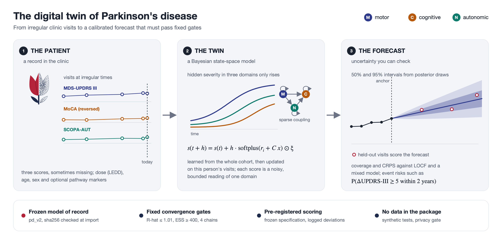
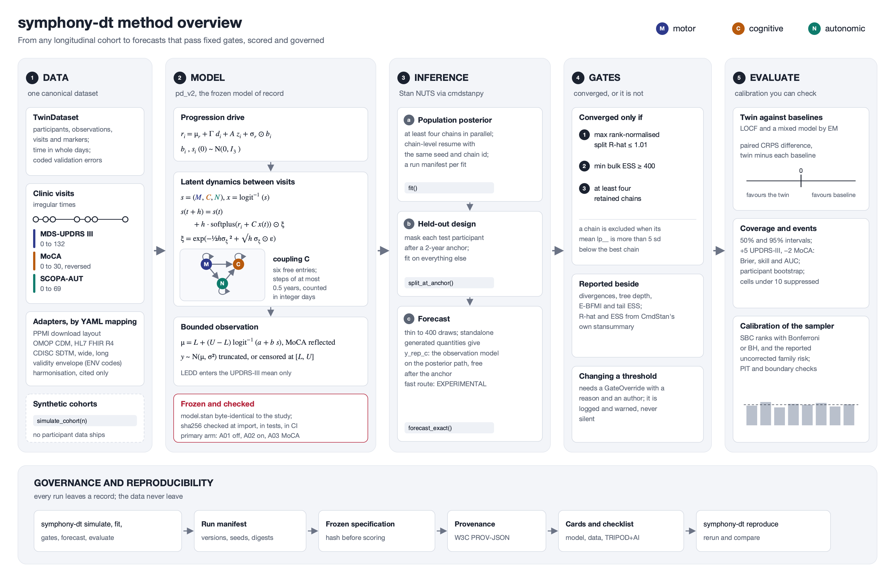

<p align="center">
  <picture>
    <source media="(prefers-color-scheme: dark)" srcset="https://raw.githubusercontent.com/a7med7emedan/symphony-dt/v2.0.1/docs/assets/brand/symphony-dt-wordmark-dark.png">
    
  </picture>
</p>

<p align="center">Bayesian hierarchical state-space digital twins for longitudinal clinical cohorts.</p>

<p align="center">
  <a href="https://pypi.org/project/symphony-dt/"></a>
  <a href="https://pypi.org/project/symphony-dt/"></a>
  <a href="https://github.com/a7med7emedan/symphony-dt/actions/workflows/ci.yml"></a>
  <a href="https://a7med7emedan.github.io/symphony-dt/"></a>
  <a href="https://a7med7emedan.github.io/symphony-dt/"></a>
  <a href="https://github.com/a7med7emedan/symphony-dt/blob/main/LICENSE"></a>
</p>

symphony-dt builds, checks, calibrates, forecasts with and audits Bayesian digital twins of longitudinal clinical
cohorts. It ships **pd_v2**, the frozen model of the SYMPHONY v2 study of Parkinson's disease progression. pd_v2
follows MDS-UPDRS Part III, MoCA and SCOPA-AUT over time, in Stan, driven from Python with cmdstanpy.

**Developed by Ahmed Hemedan.** Validation manuscript in preparation.

<p align="center"></p>

The logo is a red tulip, the symbol of Parkinson's disease. Its solid half is the patient. Its dotted half is the
digital twin, drawn as posterior samples.

## Install

```bash
pip install "symphony-dt[io]"
python -m cmdstanpy.install_cmdstan --version 2.39.0
symphony-dt check --compile
```

Or use the container image, with CmdStan installed and pd_v2 already compiled, for Linux on Intel or ARM and for
Apple silicon:

```bash
docker run --rm -v "$PWD":/work ghcr.io/a7med7emedan/symphony-dt:2.1.1 check
```

## A ten-line example

```python
import numpy as np
from symphony_dt.data import simulate_cohort
from symphony_dt.fit import fit
from symphony_dt.forecast import split_at_anchor, forecast_exact

cohort = simulate_cohort(60, seed=1)                       # synthetic data only
split = split_at_anchor(cohort.stan_data, list(range(0, 60, 4)), anchor_years=2.0)
result = fit(split.fit, chains=4, iter_warmup=1000, iter_sampling=1000, output_dir="run")
print("\n".join(result.gates().summary_lines()))           # the study's convergence gates
forecast = forecast_exact(result, split, total_keep=400)
print(forecast.interval(0.95).head())
```

## How it works

<p align="center"></p>

## What it does

- A validated, long-format data model with a design-envelope check. Adapters read wide tables, OMOP CDM, HL7 FHIR
  R4, CDISC SDTM and the PPMI download layout.
- The pd_v2 model of record, byte-identical to the study and checked by sha256 at import.
- Fitting with chain-level resume, and the study's convergence gates fixed in one place.
- Exact forecasts by the study's design, and an experimental fast route for new participants.
- The scoring code of record: interval coverage, CRPS, LOCF and mixed-model baselines, events, bootstrap.
- Simulation-based calibration with explicit multiplicity control, and posterior predictive checks.
- Run manifests, data fingerprints, pre-registration freezes, PROV provenance, model and data cards.
- One study file runs everything, with eligibility rules and an attrition table, a data profile, tidy tables and
  plots for every step.
- A living twin (EXPERIMENTAL) that updates with each visit and monitors its own calibration with an anytime-valid
  e-process. It recalibrates online, suggests the most informative next visit and relearns with lineage.
- Runs anywhere: Slurm job arrays, Docker and Apptainer, portable run bundles, JSON Schemas and a JSON twin service.
- An open synthetic benchmark against LOCF and a mixed model.

Every public function carries a validation label: VALIDATED, TESTED or EXPERIMENTAL. See the
[documentation](https://a7med7emedan.github.io/symphony-dt/).

## Governance

> **No participant data ship with this package, and none may be added.** Tests, examples and tutorials use the
> package's own simulator. A privacy gate runs before every commit and in CI. The model was developed on PPMI data
> under the PPMI data use agreement; obtain PPMI data yourself from PPMI. No PPMI-derived result appears here until
> the validation manuscript is published. The twin's forecasts are associational: no causal, treatment or
> deployment claim is made. See [GOVERNANCE.md](https://github.com/a7med7emedan/symphony-dt/blob/main/GOVERNANCE.md).

## Citation

> Hemedan A. symphony-dt: Bayesian digital twins of Parkinson's disease progression, version 2.0.0.
> https://github.com/a7med7emedan/symphony-dt

See [CITATION.cff](https://github.com/a7med7emedan/symphony-dt/blob/main/CITATION.cff).

## Licence

BSD-3-Clause, copyright Ahmed Hemedan. Version 1 remains on the `v1` branch and the `v1.0-preprint` tag under its
original Apache-2.0 licence.
