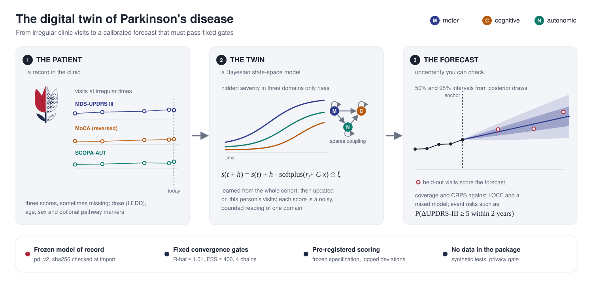

# Digital twins

A digital twin, in this package, is a statistical model of one person's disease course. It learns from a cohort
and then updates on the person's own visits. It returns a forecast with uncertainty, not a single number.

The twin has two layers. The population layer describes how disease progresses across many people. The
participant layer describes how one person differs from that pattern. Fitting the model learns both layers
together, so a person with few visits borrows strength from the cohort.

A twin is useful only if its uncertainty is honest. A 95% forecast interval should contain the later score about
95 times in 100. symphony-dt therefore treats calibration as a first-class output. It scores every forecast
against simple baselines, and it records how each number was produced.

The twin is associational. It describes how scores moved in the cohort it learned from. It does not say what a
treatment would do, and it is not validated for clinical decisions.
