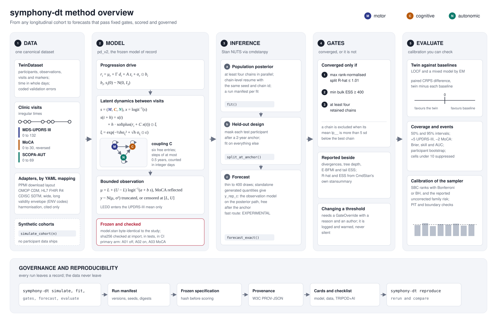

# The state-space model

## In plain words

Each person has a hidden disease severity in three domains: motor, cognitive and autonomic. Severity never goes
down. How fast it rises depends on the person, on age, sex and an assay flag, and on the current severity of the
domains. Random, positive shocks perturb each step. A clinical score is a noisy reading of one domain, squeezed
into the instrument's range.

"State-space" means the model separates the hidden state from what is observed. The hidden state evolves in time.
The observations are measured on it.

## In equations

For participant \(i\), latent state \(s_i(t) \in \mathbb{R}^3\) and \(x = \operatorname{logit}^{-1}(s)\), one step of
length \(h\) years is

\[
s_i(t+h) = s_i(t) + h \, \operatorname{softplus}\!\left(r_i + C\,x_i(t)\right) \odot \xi,
\qquad
\xi_j = \exp\!\left(-\tfrac12 h \sigma_{\xi,j}^2 + \sqrt{h}\,\sigma_{\xi,j}\,\varepsilon_j\right).
\]

Here \(\varepsilon \sim N(0, I_3)\), so \(E[\xi_j] = 1\) and every increment is non-negative. The participant rate is

\[
r_i = \mu_r + \Gamma d_i + A z_i + \sigma_r \odot b_i, \qquad b_i \sim N(0, I_3), \qquad s_i(0) \sim N(0, I_3).
\]

\(d_i\) holds centred age in decades, sex and an assay-availability flag. \(z_i\) holds optional pathway scores.
\(C\) is a sparse coupling matrix with six free entries.

Endpoint \(k\) with range \([L_k, U_k]\) has mean

\[
\mu_{ik} = L_k + (U_k - L_k)\,\operatorname{logit}^{-1}(a_k + b_k s_{ik}),
\]

with the MoCA mean reflected, because lower MoCA means worse cognition. LEDD enters the UPDRS-III mean only. The
observation density is a Gaussian truncated to \([L_k, U_k]\), or censored at the bounds for MoCA in the primary arm.

## The step grid

Each interval between visits is split into equal sub-steps of at most 0.5 years. The number of sub-steps is
computed in integer days, so no floating-point rounding can move a step boundary between computers.

## What is frozen

The Stan program `model.stan` is byte-identical to the study's program. Its sha256 is checked when the model is
imported. New models live beside it under their own names.
