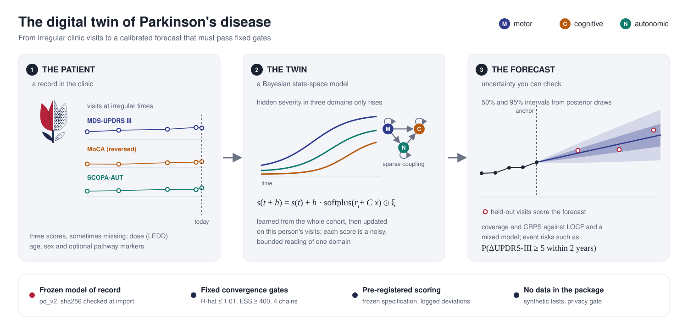

# symphony-dt

{ width="560" }

**symphony-dt** builds, checks, calibrates, forecasts with and audits Bayesian digital twins of longitudinal
clinical cohorts. It ships **pd_v2**, the frozen model of the SYMPHONY v2 study of Parkinson's disease progression.
pd_v2 tracks three scores over time: MDS-UPDRS Part III, MoCA and SCOPA-AUT.

Developed by Ahmed Hemedan.

The logo is a red tulip, the symbol of Parkinson's disease. Its solid half is the patient. Its dotted half is the
digital twin, drawn as posterior samples.

!!! note "Validation manuscript in preparation"
    The study's results on the Parkinson's Progression Markers Initiative (PPMI) will appear in the validation
    manuscript. These pages explain the methods. They report no PPMI number.

## What the package does

| task | where |
|---|---|
| hold a cohort in one validated, long-format data model | [Data](guide/data.md) |
| read your own data from wide tables, OMOP, FHIR, SDTM or a PPMI download | [Interoperability](interoperability.md) |
| check that a cohort sits inside the model's design envelope | [Data](guide/data.md#validity-envelope) |
| simulate synthetic cohorts from the generative model | [Data](guide/data.md#simulation) |
| fit pd_v2 with Stan and judge convergence by fixed gates | [Fitting and gates](guide/fit.md) |
| forecast held-out visits, exactly or quickly | [Forecasting](guide/forecast.md) |
| score forecasts against LOCF and a mixed model | [Evaluation](guide/evaluate.md) |
| run simulation-based calibration and predictive checks | [Calibration checks](guide/calibration.md) |
| record manifests, provenance, frozen specifications and reports | [Governance](guide/governance.md) |

## Validation labels

Every public function carries one of three labels. **VALIDATED** marks the pd_v2 model and the evaluation code of
record, as used in the SYMPHONY v2 study. **TESTED** marks code that is correct on synthetic data and unit tests,
but has not been validated on a clinical cohort. **EXPERIMENTAL** marks code whose design is not settled.
The [validation status](validation-status.md) page lists every label.

## Scope

symphony-dt produces associational forecasts with uncertainty. It makes no causal claim and supports no treatment
decision. It is research software, not a medical device.
